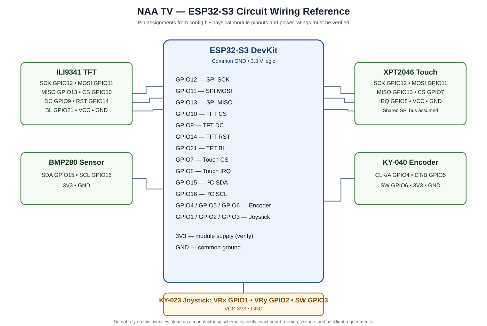

# NAA TV — ESP32-S3 Handheld Smart Device

A multifunctional handheld smart device built using the ESP32-S3, featuring a touchscreen interface, internet-connected services, productivity tools, environmental monitoring, and built-in games.

## Overview

NAA TV is a handheld smart device designed to combine everyday utilities, study-related activities, and entertainment in one compact system.

The device integrates a 2.8-inch SPI TFT touchscreen, an ESP32-S3 microcontroller, input modules, and a BMP280 sensor. Its firmware is organized into separate modules for user-interface functions, games, networking, sensors, alarms, and other features.

## Features

- **Time and Date:** Displays time and date.
- **Live Weather:** Retrieves weather information for four cities using an internet connection.
- **Live News and Quotes:** Displays online news and quotes.
- **Environmental Monitoring:** Measures temperature and atmospheric pressure using the BMP280 sensor.
- **Pomodoro Timer:** Supports focused work sessions.
- **Timer, Stopwatch, and Alarm:** Provides time-management utilities.
- **Calculator:** Performs calculations.
- **Sketch Pad:** Provides a drawing interface.
- **Document Reader:** Allows users to read supported text documents.
- **10 Built-in Games:** Offers gaming and entertainment.
- **Custom Settings UI:** Provides options for configuring device behavior.
- **Touch and Physical Controls:** Supports interaction through the touchscreen, rotary encoder, and joystick.

## Hardware Components

- ESP32-S3 development board
- 2.8-inch SPI TFT touchscreen
- KY-040 rotary encoder
- KY-023 joystick module
- BMP280 temperature and pressure sensor
- Supporting resistors, capacitors, and wiring

## Technologies Used

- **Programming Language:** C++
- **Microcontroller:** ESP32-S3
- **Development Environment:** Arduino IDE 2.3.10
- **Graphics Framework:** LVGL
- **Communication Interfaces:** SPI, I2C, and GPIO
- **Wireless Connectivity:** Wi-Fi
- **Embedded Systems:** Modular firmware, hardware integration, input handling, and sensor interfacing
- **Internet Integration:** Weather, news, quotes, and time services

Exact library names, versions, and build dependencies will be documented after verification.

## Firmware Architecture

The project uses separate source and header files to organize its functionality.

- `NAA_TV.ino` — Main Arduino sketch.
- `config.h` — Hardware pin definitions, screen settings, and configuration constants.
- `alarm.cpp` and `alarm.h` — Alarm-related functionality.
- `power.cpp` and `power.h` — Power and idle behavior.
- `touch.cpp` and `touch.h` — Touchscreen handling.
- `ui.cpp` and `ui.h` — User-interface functionality.
- `joystick.cpp` and `joystick.h` — Joystick handling.
- `sensors.cpp` and `sensors.h` — Sensor-related functionality.
- `storage.cpp` and `storage.h` — Data storage functionality.
- `net.cpp` and `net.h` — Network functionality.
- `weather.cpp`, `weather.h`, and `weather_async.cpp` — Weather-related functionality.
- `news.cpp` and `news.h` — News functionality.
- `quotes.cpp` and `quotes.h` — Quotes functionality.
- `games.cpp` and `games.h` — Game management.
- `game_*.cpp` and `game_*.h` — Individual game modules.

The firmware also contains calculator, timer, stopwatch, document-reader, sketch-pad, and other feature modules as implemented in the source code.

## Hardware Pin Configuration

The following GPIO assignments are taken from `config.h`.

| Signal | ESP32-S3 GPIO |
|---|---|
| TFT CS | 10 |
| TFT DC | 9 |
| TFT Reset | 14 |
| TFT MOSI | 11 |
| TFT MISO | 13 |
| TFT SCK | 12 |
| TFT Backlight | 21 |
| Touch CS | 7 |
| Touch IRQ | 8 |
| I2C SDA | 15 |
| I2C SCL | 16 |
| Encoder A | 4 |
| Encoder B | 5 |
| Encoder Switch | 6 |
| Joystick X | 1 |
| Joystick Y | 2 |
| Joystick Button | 3 |

Confirm the actual board and module wiring before using these assignments to construct a physical circuit.

## Circuit Diagram

The circuit schematic will document the connections between the ESP32-S3, touchscreen, touch controller, BMP280 sensor, rotary encoder, joystick, and power supply.

The verified circuit diagram will be added to the repository when available.

## Getting Started

### Requirements

- Arduino IDE
- Compatible ESP32 board support package
- Required libraries for the display, touch interface, LVGL, BMP280, networking, and other modules
- The complete NAA TV source code
- An ESP32-S3 board and the required hardware

### Setup

1. Install Arduino IDE.
2. Install the compatible ESP32 board support package.
3. Install the libraries required by the project.
4. Open `NAA_TV.ino` in Arduino IDE.
5. Select the correct ESP32-S3 board and connection port.
6. Configure any required Wi-Fi credentials and API settings locally.
7. Verify the code, connect the device, and upload the firmware.

The exact board selection, library versions, and configuration steps must be confirmed from the project files.

## Development Focus

- Responsive touchscreen UI using LVGL
- Modular firmware architecture
- Real-time internet data integration
- Hardware and sensor integration
- Touch and physical-input handling
- Performance optimization and smooth rendering

## Future Improvements

- Refine the user interface and animations.
- Improve power management and reliability.
- Expand device customization.
- Add a verified circuit schematic and wiring documentation.
- Improve setup instructions and developer documentation.

## Project Status

Actively being refined, with additional improvements and features planned.

## Circuit Diagram

The NAA TV project includes circuit documentation and hardware pin mapping.

- [KiCad Schematic](NAA_TV_Circuit.kicad_sch)
- [Pin Mapping Table](NAA_TV_Pin_Map.csv)
- [Circuit Documentation](README_CIRCUIT.md)

## Author

Kirla Venkata Sai
